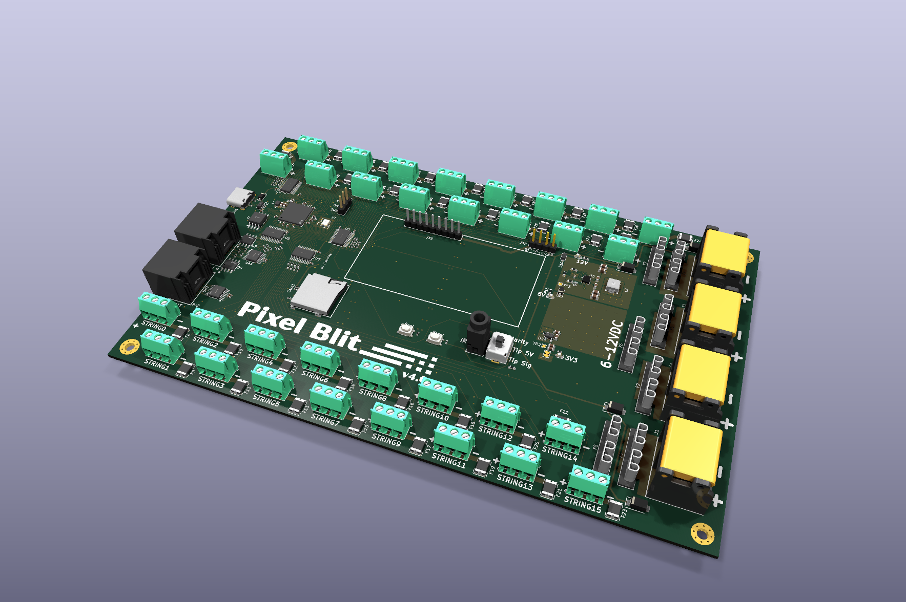
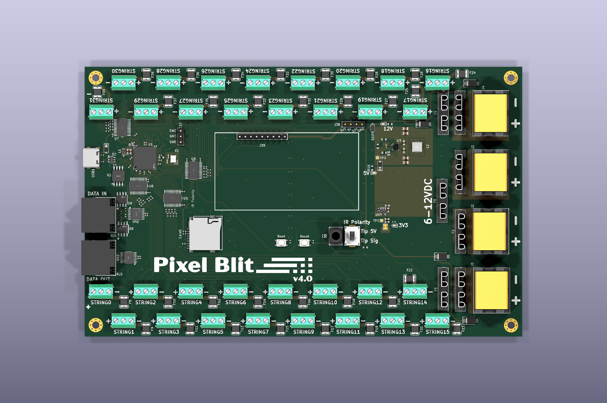

# pixel_blit

A 32-channel addressable LED controller based on the Raspberry Pi RP2350B microcontroller.



<details>
<summary>Top view</summary>



</details>

> **Status:** the images show v4.0. This branch (`v5`) is the next revision:
> Wi-Fi instead of LVDS, four independent 5-24 V power zones, a new power
> supply and an on-board status LED and button. It is designed but not yet
> built; bring-up and firmware come after prototyping the RM2 module and
> receiving boards. Design notes, part choices and as-built values are in
> [docs/next-revision.md](docs/next-revision.md).

## Overview

The pixel_blit drives up to 32 strings of addressable LEDs from one board. The
outputs are split into four power zones, each with its own supply input, so
5 V, 12 V and 24 V pixels can run from the same controller. Shows play from a
microSD card; the board is set up and controlled over Wi-Fi, USB or an IR
remote.

## Key Specifications

- **Microcontroller**: Raspberry Pi RP2350B (QFN-80)
  - Dual Cortex-M33 cores @ 150 MHz
  - 12 PIO state machines for LED timing
  - USB Full Speed (12 Mbps)

- **Output Channels**: 32 independent LED string outputs
  - 3.3 V to 5 V level shifting (4× SN74LVC8T245)
  - 47 Ω series resistor on every data line
  - 3 A / 30 V resettable fuse (PTC) on every port
  - Screw terminals (3.5 mm pitch): power, data, ground

- **Power Zones**: 4 zones of 8 outputs each
  - One input per zone, **5-24 V DC**
  - 20 A blade fuse and 26 V TVS on each input
  - A blown-fuse LED beside each fuse
  - Silkscreen key with a write-in voltage box per zone

- **Memory**:
  - 16 MB QSPI flash (W25Q128JV)
  - 8 MB QSPI PSRAM (APS6404L), on the flash bus
  - microSD card slot for shows and settings

- **Wireless**: Raspberry Pi RM2 module (CYW43439, 2.4 GHz Wi-Fi and Bluetooth)

- **User Interface**:
  - Common-cathode RGB status LED
  - Play button, plus Boot and Reset buttons
  - IR receiver jack with a polarity switch
  - USB-C

## Power

```
Zone inputs 1-4 (5-24 V each)
  → 20 A blade fuse → SMBJ26A TVS → zone rail VZ1-VZ4 → 8 ports, each through a 3 A PTC
  → SS34 diodes (OR of all four zones) → VIN_SYS
       → TPS552872 buck-boost (4.5-28 V in) → 5.2 V → B5819W → +5 V (level shifters)
       → TPS62A02A buck → 3.3 V (MCU, flash, PSRAM, Wi-Fi, SD)
       → RP2350B internal regulator → 1.1 V core
```

The logic supply runs from whichever zones are powered, so any one input is
enough to run the board. USB can power the logic alone. A 4-pin header (3.3 V,
5 V, VIN, GND) allows external supplies; see the notes on the schematic before
using it.

## Signal Path

```
RP2350B GPIO (3.3 V)
  → SN74LVC8T245 level shifter (4× 8-channel)
  → 47 Ω series resistor
  → screw terminal
  → LED string
```

24 V pixels still take 5 V logic data.

## Pin Map

| GPIO | Function |
|---|---|
| 0-31 | LED strings (firmware maps string numbers to GPIOs) |
| 32-35 | RM2 Wi-Fi (power, chip select, data, clock) |
| 36-39 | microSD (SPI) |
| 40 | Play button (to GND, internal pull-up) |
| 41, 43, 45 | Status LED blue, red, green |
| 42 | IR receiver |
| 44, 46 | Spare |
| 47 | PSRAM chip select (XIP_CS1) |

Strings are numbered by zone on the silkscreen: zone 1 is S0-S7, zone 2 S8-S15,
zone 3 S16-S23, zone 4 S24-S31.

## Board Details

- **PCB size**: 197.5 mm × 122.1 mm
- **Layers**: 4 (signal / GND / GND with a local 3.3 V area / signal and GND)
- **Assembly**: all parts on the top side
- **Connectors**:
  - 32× DB301V 3.5 mm screw terminals (LED outputs)
  - 4× DBT50G 9.5 mm screw terminals (zone power inputs)
  - 4× XF-507P blade fuse holders
  - USB-C, microSD, IR jack, SWD header, power override header

## Component Summary

| Type | Count | Notes |
|------|-------|-------|
| Resistors | 66 | 47 Ω series resistors, regulator feedback, LED resistors |
| Capacitors | 49 | Decoupling, regulator input and output |
| Fuses | 36 | 32 port PTCs, 4 blade fuse holders |
| ICs and modules | 10 | MCU, flash, PSRAM, RM2, 4 level shifters, 2 regulators |
| Diodes and LEDs | 19 | OR diodes, TVS, USB protection, status and fuse LEDs |
| Terminal blocks | 36 | 32 LED outputs, 4 zone inputs |
| Buttons and switches | 4 | Play, Boot, Reset, IR polarity |

## File Structure

```
pixel_blit/
├── pixel_blit.kicad_pcb      # PCB layout
├── pixel_blit.kicad_sch      # Top-level schematic: MCU, flash, PSRAM, USB, status LED, buttons
├── Power.kicad_sch           # Zone inputs, buck-boost, 3.3 V buck, fuse LEDs
├── output.kicad_sch          # Level shifters, series resistors, PTCs, terminals
├── wireless.kicad_sch        # RM2 Wi-Fi module
├── peripherals.kicad_sch     # microSD, IR receiver
├── PixelBlit.kicad_sym/.pretty, JLCImport.kicad_sym/.pretty  # Project libraries
├── docs/                     # Design notes (next-revision.md) and images
└── production/               # Manufacturing outputs
```

## Use Cases

- Architectural lighting installations
- Stage and entertainment lighting
- Large-scale pixel displays
- Holiday and decorative lighting
- Interactive art installations

## License

MIT License
